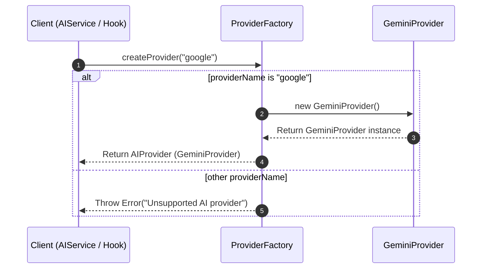
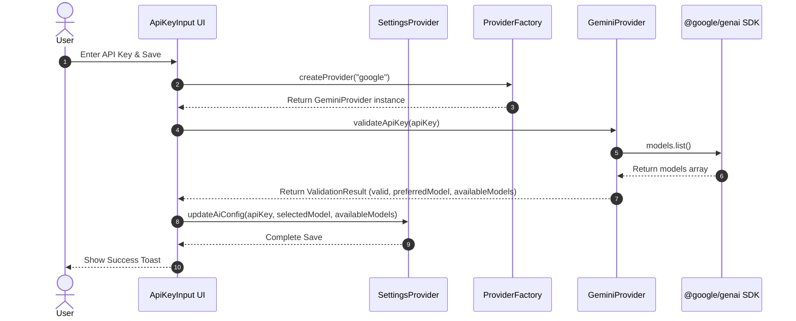
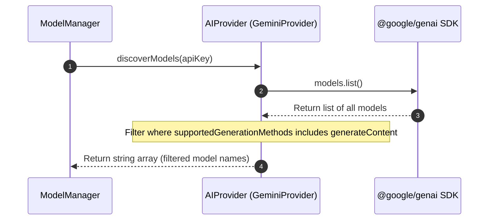
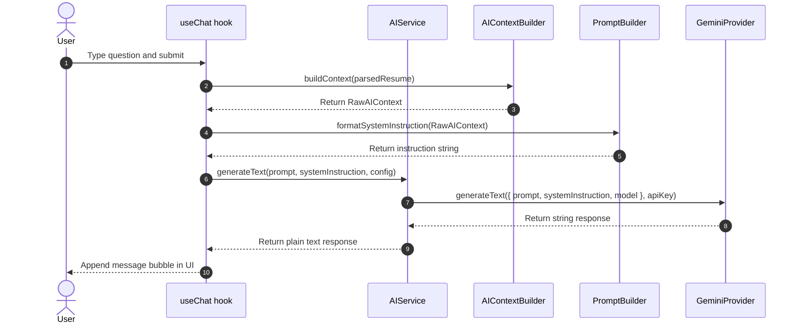
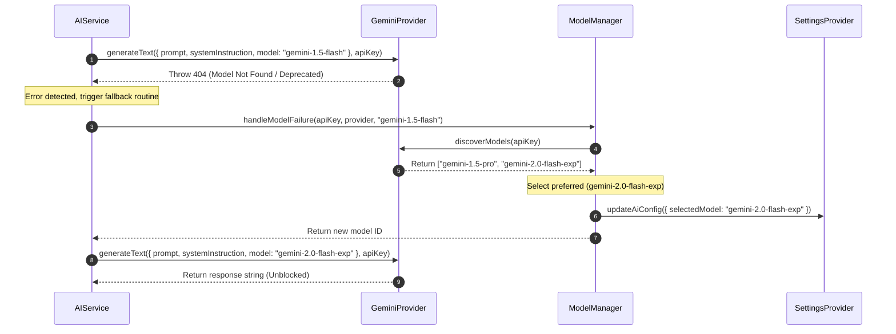

# Lative AI Platform Architecture

**Version:** 1.0 (Refactored AI Foundation)  
**Status:** Approved Specification  

---

## 1. Purpose

### Goals of the AI Platform
The AI platform is designed to provide a highly extensible, robust, and provider-agnostic system for executing intelligent operations on top of career contexts. 
- **Provider Abstraction**: Decouple the core application logic from specific vendor SDKs (e.g., Google, OpenAI) using clean interface boundaries.
- **Dynamic Model Management**: Automatically discover, rank, and failover between generative models to prevent hardcoded model depreciation.
- **Fail-Safe Self-Healing**: Automatically recover from model-not-found errors by running rediscovery routines in the background.

### Non-Goals
- **Automated Actions**: User career details are never automatically submitted to forms.
- **Cloud Persistence**: Session histories and query logs are kept strictly in React memory state and never written back to disk or external servers.

### Privacy-First Principles
- **Local Keys Only**: All credentials (e.g., Gemini API keys) are stored locally in `chrome.storage.local` and never transit to third-party databases.
- **Direct Transactions**: The extension initiates direct HTTPS communication from the browser client to the provider's API. No intermediate proxies or servers are used.

---

## 2. High-Level Architecture

```mermaid
graph TD
    UI[UI Components / Hooks] -->|Query/Validate| AIS[AIService]
    UI -->|Settings Context| SP[SettingsProvider]
    AIS -->|Fetch Config| SP
    AIS -->|Get Model| MM[ModelManager]
    AIS -->|Compile Context| CB[AIContextBuilder]
    AIS -->|Format Prompt| PB[PromptBuilder]
    AIS -->|Create Client| PF[ProviderFactory]
    PF -->|Instantiates| AP[AIProvider Interface]
    AP -->|Implements| GP[GeminiProvider]
    GP -->|Calls API| GSDK[@google/genai SDK]
    MM -->|Validate/Discover| AP
    MM -->|Update Config| SP
```

---

## 3. AI Platform Components

### AIService
- **Namespace**: `src/modules/ai/services/aiService.ts`
- **Responsibility**: Coordinates prompt formatting, context assembly, and text generation. Acts as the primary gateway for UI components. It has zero knowledge of Google SDK syntax.

### AIProvider (Interface)
- **Namespace**: `src/modules/ai/providers/AIProvider.ts`
- **Responsibility**: Declares the contract for AI provider operations (`validateApiKey`, `discoverModels`, `generateText`, `healthCheck`).

### ProviderFactory
- **Namespace**: `src/modules/ai/providers/ProviderFactory.ts`
- **Responsibility**: Instantiates implementations of the `AIProvider` interface dynamically based on a provider identifier string (e.g. `"google"`).

### GeminiProvider
- **Namespace**: `src/modules/ai/providers/GeminiProvider.ts`
- **Responsibility**: Implements `AIProvider` using the official `@google/genai` SDK. This is the **only** file in Lative allowed to import the Google GenAI SDK.

### ModelManager
- **Namespace**: `src/modules/ai/services/modelManager.ts`
- **Responsibility**: Handles model selection rankings, fallbacks on errors, model configuration validation, and cache lifecycle flushes.

### AIContextBuilder
- **Namespace**: `src/modules/ai/context/aiContextBuilder.ts`
- **Responsibility**: Gathers disparate raw application variables (resumes, page HTML data, user configurations) and packages them into a structured raw context.

### PromptBuilder
- **Namespace**: `src/modules/ai/services/promptBuilder.ts`
- **Responsibility**: Formats the compiled raw context into system instruction text blocks and user queries, enforcing strict anti-hallucination guardrails.

### SettingsProvider Integration
- **Namespace**: `src/modules/settings/providers/SettingsProvider.tsx`
- **Responsibility**: Reactively distributes the structured `AIConfig` configurations across active extension views.

---

## 4. Data Flow

### API Key Validation & Model Discovery
```text
User inputs Key 
      ↓
ProviderFactory creates Google Provider 
      ↓
GeminiProvider executes Models list check 
      ↓
Filter models supporting generateContent 
      ↓
ModelManager selects preferred model (e.g., gemini-1.5-flash)
      ↓
Persist structured AIConfig to settings storage
```

### Chat Generation
```text
User submits prompt
      ↓
AIContextBuilder compiles active resume context
      ↓
PromptBuilder formats System Instructions and user prompt
      ↓
AIService requests model from ModelManager
      ↓
ProviderFactory retrieves Provider
      ↓
GeminiProvider executes generateContent using @google/genai SDK
      ↓
Plain-text response renders in UI
```

### Resume Analysis
```text
User triggers resume analysis quick action
      ↓
AIService requests active parsed resume from resumeStore
      ↓
AIContextBuilder compiles parsed resume object as RawAIContext
      ↓
PromptBuilder formats summary/analysis instructions for context
      ↓
AIService requests generation on active Google Provider
      ↓
GeminiProvider executes generation; outputs summarized analysis in plain text
```

### Future Page Analysis
```text
Content script extracts DOM/webpage details
      ↓
Content script sends PAGE_CAPTURE message to background script
      ↓
AIContextBuilder compiles webpage details and user's active resume
      ↓
PromptBuilder formats prompt mapping webpage contents to candidate qualifications
      ↓
AIService queries the AI provider with active model
      ↓
Response returned displaying match highlights and tips in the UI overlay
```

### Future JD Comparison
```text
User pastes job description into comparison form
      ↓
AIContextBuilder bundles raw JD text paste alongside active resume
      ↓
PromptBuilder constructs evaluation checklist (skills, keywords, experience gap)
      ↓
AIService executes comparison generation via AIProvider
      ↓
UI renders side-by-side gap analysis (matching vs. missing items)
```

---

## 5. Sequence Diagrams

### Provider Initialization



### API Key Validation



### Model Discovery



### Chat Request



### Model Fallback (Self-Healing)



---

## 6. Model Management

### Discovery & Selection
When a key is saved, Lative queries the Google Models list. The retrieved list of models is filtered to ensure they support the `generateContent` method. The filtered array is ranked against Lative's model preferences:
1. `gemini-1.5-flash`
2. `gemini-2.0-flash-exp`
3. `gemini-1.5-pro`
4. Fallback (First model in the list supporting text generation).

### Fallback & Self-Healing Strategy
If an active model fails during a query due to a `404` or `model not found` error:
1. The error is intercepted by `AIService`.
2. `ModelManager.handleModelFailure` is triggered.
3. The manager queries the Models list again to discover available models.
4. The ranking is recalculated, settings are updated, and the request is retried **once**.
5. If the retried request fails, the error is surfaced to the user.

### Cache Lifecycle
Available models and validation timestamps are cached in Settings storage (`chrome.storage.local`). The cache is cleared when the API key is updated or removed.

---

## 7. Prompt Lifecycle

1. **Context Collection**: The UI/hook calls `AIContextBuilder` to compile active resume data, current URL, page text, and other inputs.
2. **Prompt Building**: `PromptBuilder` formats this data into standard system instructions (enforcing strict plain-text configurations and anti-hallucination guards) and trims user questions.
3. **Provider Execution**: `AIService` initializes the appropriate provider via `ProviderFactory` and runs the query using the configured model.
4. **Response Processing**: Outputs are validated as raw strings and passed directly back to the UI. Markdown formatting is completely stripped/prevented.

---

## 8. Privacy & Security

- **Local Storage ONLY**: No parsed resume text is ever sent to intermediate sync services.
- **Direct SDK Transactions**: `@google/genai` is configured to communicate directly with Google's API endpoint.
- **Zero Query Persistence**: Session histories are kept strictly in React state memory and are cleared when the popup window closes or when the active resume profile changes.

---

## 9. Error Handling

- **Invalid Key**: Validation intercepts status codes `400` or `403` and throws `"Invalid API Key. Access denied."`
- **Network Failure**: Intercepts `TypeError` and throws `"Network error. Please check your internet connection."`
- **Timeout**: Enforces standard query timeouts.
- **Quota Exceeded**: Intercepts status code `429` and throws `"Quota limits exceeded. Please check your Gemini API account limits."`

---

## 10. Extensibility

### Supporting Future Providers
To support a new provider (e.g. `openai`):
1. Create a `src/modules/ai/providers/OpenAIProvider.ts` class implementing `AIProvider`.
2. Update `ProviderFactory.createProvider` to resolve `"openai"` to the new class:
   ```typescript
   if (providerName === 'openai') return new OpenAIProvider();
   ```
3. Extend the settings `AIConfig` model properties to support the new provider's configuration.

---

## 11. Design Decisions

- **Unified Client (`@google/genai`)**: Replaces the legacy `@google/generative-ai` package to target the stable `v1` endpoint by default.
- **Factory Pattern**: Separates the UI layers from provider-specific SDK bindings.
- **Structured Config Object**: Bundles API parameters (available models, selected model, validated status) into a clean state object, avoiding individual configuration variables.

---

## 12. Folder Structure

The refactored AI module directory tree:
```text
src/modules/ai/
├── components/
│   ├── AiPanel.tsx
│   ├── ChatContainer.tsx
│   ├── ChatMessage.tsx
│   └── ResumeSelector.tsx
├── context/
│   └── aiContextBuilder.ts
├── hooks/
│   ├── useAiContext.tsx
│   └── useChat.ts
├── providers/
│   ├── AIProvider.ts
│   ├── GeminiProvider.ts
│   └── ProviderFactory.ts
├── services/
│   ├── aiService.ts
│   ├── modelManager.ts
│   └── promptBuilder.ts
├── utils/
│   └── validateApiKey.ts
└── index.ts
```

---

## 13. Future Expansion

- **Job Description Comparison**: Will compile JD text inputs inside `AIContextBuilder` and request structured validation assessments.
- **Auto-Fill Prompts**: Will consume specific input fields from page content scripts to construct fill responses dynamically.
